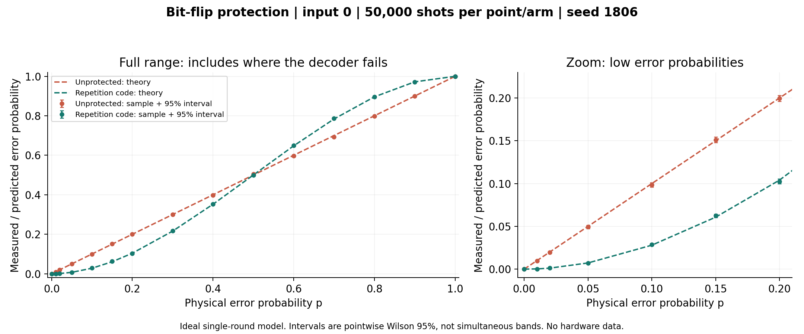
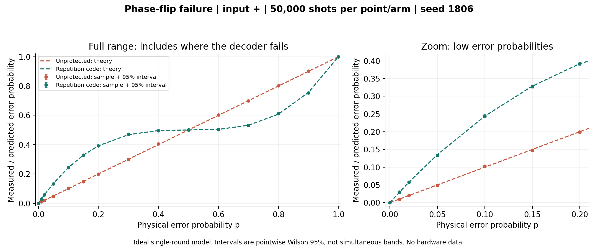

# Quantum Experiment Workbench

**When does protecting one qubit with three qubits actually help?**

A small, reproducible investigation into the three-qubit bit-flip repetition code. Built as the next step after [One-Qubit Gate Explorer](https://github.com/devika1806/one-qubit-gate-explorer): first understand gates and measurements; then ask how to protect information when errors occur.

For independent bit flips with probability p and ideal encoding/recovery, a fixed majority decoder has error probability **3p² − 2p³**. It improves on an unprotected qubit for **0 < p < 0.5**. This is a known theoretical result we reproduce and test, not a new discovery or a hardware threshold.



## Try it without installing packages

Use Python 3.11 or newer (Python 3.12 recommended for a fresh setup). Open a terminal in this folder. On macOS/Linux, use `python3` instead of `python` outside a virtual environment:

```powershell
python -m workbench --rates 0,0.05,0.1,0.2,0.5,0.8,1 --shots 20000 --seed 1806 --out local-runs/first
```

Read the observed and predicted rates. At p=0.1, expect approximately 10% errors unprotected and 2.8% with the code. Samples fluctuate. JSON and CSV are saved in `local-runs/first`; reruns refuse to overwrite them unless you add `--force`.

## Open the interactive workbench

Windows PowerShell:

```powershell
python -m venv .venv
.\.venv\Scripts\python.exe -m pip install -r requirements.txt
.\.venv\Scripts\python.exe -m streamlit run app.py
```

macOS or Linux terminal:

```sh
python3 -m venv .venv
.venv/bin/python -m pip install -r requirements.txt
.venv/bin/python -m streamlit run app.py
```

Open the local URL printed by Streamlit; stop with Ctrl+C. No account, API token or paid quantum service is required. The UI dependencies are pinned; the core and CLI use only the Python standard library.

**Platform status:** Windows is locally tested. The code is designed for Windows, macOS and Linux, and CI checks are configured for all three; macOS/Linux execution is pending. See [platform setup and verification details](docs/PLATFORMS.md). The localhost demo is only available on the computer running it. GitHub publication shares the source; a public browser demo requires separate hosting.

Choose an input (0 or 1), probability, shot count and seed. Write a prediction, run a point or sweep, inspect the graph and physical error patterns, and download the evidence. The interface labels old results if you change settings before rerunning.

## See the limitation, not just the success

```powershell
python -m workbench --noise phase --rates 0,0.05,0.1,0.2,0.5,1 --shots 20000 --seed 1806 --out local-runs/phase
```

The phase demonstration always uses **plus input and X readout** with the same bit-flip code. Odd numbers of Z errors survive recovery, giving error probability **3p(1−p)² + p³**. At p=0.1 it is 24.4%, worse than the unprotected 10%. A Z measurement of a 0/1 input would hide phase damage.



## What is implemented

- Pure simulation engine, separate versioned experiment records, CLI, and Streamlit interface.
- Independent physical-error samples for each arm and probability, reproducible SHA256-derived seeds, and an eight-pattern audit trail.
- Exact theory, separate exhaustive pattern enumeration, sample counts, and approximate pointwise 95% Wilson intervals.
- JSON with settings, provenance, patterns and notes; CSV with measurement rows, settings and source fingerprint.
- Boundary, decoder, uncertainty, export, CLI and UI tests; independent ideal quantum-circuit checks with Qiskit.
- A GitHub Actions workflow covering Windows, macOS and Linux, ready to run when the repository is published. Local verification is documented separately; no remote CI pass is claimed.

## Learn and investigate

1. [Start here](docs/START_HERE.md): a short route from repeated bits to the quantum code.
2. [Research plan and references](docs/RESEARCH.md): question, derivation, fair comparisons and reliable sources.
3. [Architecture and critical path](docs/ARCHITECTURE.md): why this implementation stays small.
4. [Validation report](docs/SELF_CHECK.md): exactly what has been checked and what remains outside scope.

## Reproduce the checks and saved figures

```powershell
python -m unittest discover -s tests -v
# Optional dependencies for the UI, independent Qiskit verification and plots:
python -m pip install -r requirements.txt -r requirements-research.txt
python verify_quantum.py
python -m workbench --rates 0,0.01,0.02,0.05,0.1,0.15,0.2,0.3,0.4,0.5,0.6,0.7,0.8,0.9,1 --shots 50000 --seed 1806 --out results/bit --force
python -m workbench --noise phase --rates 0,0.01,0.02,0.05,0.1,0.15,0.2,0.3,0.4,0.5,0.6,0.7,0.8,0.9,1 --shots 50000 --seed 1806 --out results/phase --force
python make_figures.py
```

Run commands in the environment containing the installed dependencies. Without Streamlit, only the UI test is skipped. `--force` intentionally replaces the example records. Identical engine, settings and Python version reproduce the records; runtime version and engine hash are recorded to explain differences after upgrades. The graph generator reads saved data and never resamples it.

## Honest boundaries

One round of independent identical X errors, or a separate Z-only failure demonstration; perfect preparation, gates, recovery and readout. No simultaneous X/Z channel, faulty gates, correlated noise, repeated syndrome rounds or device timings. The comparison spends three data qubits versus one; it is not an equal-resource hardware benchmark.

The 0/1 Monte Carlo experiment is mathematically equivalent to a classical repetition-code calculation. The separate Qiskit verifier explicitly encodes superpositions, injects every error pattern, decodes and checks the recovered qubit. Neither component runs on hardware. There is no claim of quantum advantage, fault tolerance or protection against arbitrary quantum errors.

## Contributing

Keep a change tied to a testable question. Add assumptions and expected results before extending the engine; update the schema/version when changing record meaning; run tests and the independent verifier. First useful extensions: correlated X errors, a fair alternative decoder for p>0.5, then imperfect operations with a new theoretical baseline. Do not quietly reuse this formula for a different noise model.
