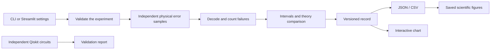

# Architecture and critical path

## A small implementation with clear jobs

| Component | Responsibility |
|---|---|
| `workbench/engine.py` | Validated settings; physics assumptions; trial generation; decoding; exact probabilities and Wilson intervals |
| `workbench/records.py` | Schema, runtime and engine provenance; JSON and CSV serialization |
| `workbench/cli.py` | Arguments, readable output and safe export destinations |
| `app.py` | Predictions, controls, plots, stale-result labels and downloads |
| `verify_quantum.py` | Independent quantum circuit evolution and recovered-state checks |
| `make_figures.py` | Static plots from recorded measurements |

No UI dependency enters the core. No theoretical probability is used to sample protected failures: each shot draws three physical errors and runs the decoder. Domain-separated seeds keep the two arms independent and make a probability's result independent of sweep order. This is deterministic pseudorandomness, not cryptography or a quantum random source.

## Options considered

| Option | Decision and reason |
|---|---|
| Plain Python physical-error patterns | Primary engine: transparent, fast and sufficient for this restricted model |
| Qiskit simulation per shot | Use as a separate exact circuit check; millions of statevector trials would obscure a simple model and slow the beginner demo |
| Streamlit | Familiar from the first project, with small setup and built-in download controls |
| Custom web backend, database or accounts | Deferred: no requirement needs them |
| Hardware execution | Deferred: introduces device noise, cost and decoder assumptions outside the current question |
| Full arbitrary error correction | Deferred: this code cannot correct both X and Z errors |

## Critical path and completion conditions

1. Define error metric and assumptions → derive the theoretical curve.
2. Implement physical patterns → exhaust all eight cases for both classical inputs.
3. Add repeated trials → seed streams, sample counts, Wilson intervals and input limits.
4. Save records → retain enough settings to reproduce measurements and never silently overwrite CLI output.
5. Check ideal quantum encoding/recovery → include superpositions and the phase failure.
6. Build the UI → compare selected settings, show uncertainty and guard against stale results.
7. Run recorded sweeps → generate graphs from saved records and document results honestly.

Display styling, additional noise models and publishing are not prerequisites for the engine's scientific validation. The essential deliverable is a reproducible question with inspectable evidence.

## Limits and performance

1–101 distinct probabilities, at most 1,000,000 shots at a point and 2,000,000 total shots per arm in one sweep. The UI intentionally offers a smaller limit. Histograms aggregate trials, so memory does not grow with shot count. Exceptions become actionable CLI/UI messages. Experiment CSV includes runtime and engine fingerprints; JSON also includes assumptions and error-pattern histograms. Neither format contains accounts or secrets.
